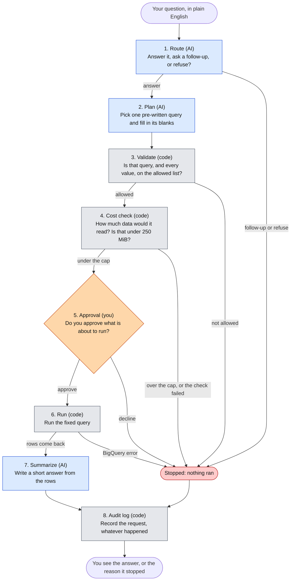
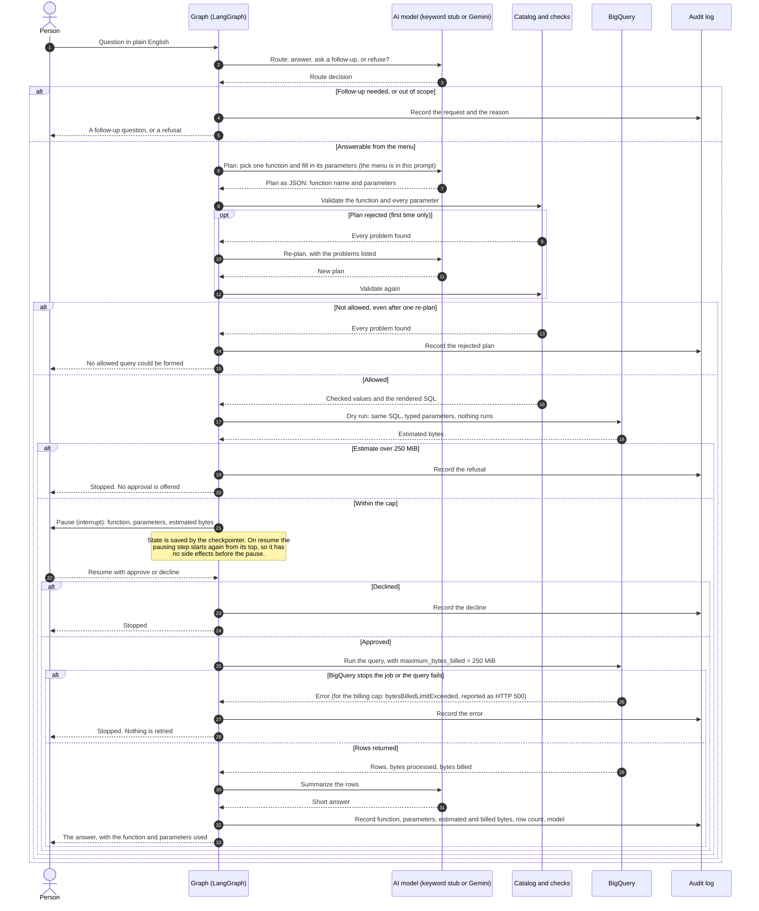
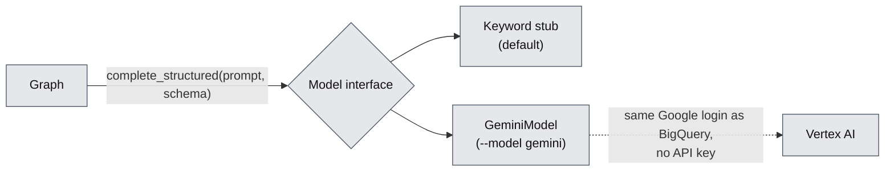

# bq-query-agent

A small AI agent that answers plain-English questions about a database, built so that the AI cannot run anything it has not been allowed to run, and a person approves every query before it runs.

Independent open-source work, built to learn Google Cloud (BigQuery) and LangGraph. It uses only public, synthetic data. It is not a production system.

## What is this?

Imagine asking a database, "What were our top products last quarter?" and getting an answer in plain English. The quick way to build that is to let an AI model write the database query itself. It works until the model writes a wrong query, an expensive one, or one that reads data it should not.

This project takes a different route. The AI never writes a query. Instead:

1. A short menu of pre-written, reviewed query functions exists (for example "revenue by month" or "top products").
2. The AI's only job is to choose one function from the menu and fill in the blanks (dates, a category, how many results).
3. Ordinary code, not the AI, checks the choice, estimates what the query would cost, and shows a person exactly what is about to run.
4. Only after a person approves does the query run, and every request is written to a log.

The short version of the rule: the model proposes, code decides.

The data is the public BigQuery dataset `thelook_ecommerce`, a synthetic online clothing store with orders, items, products and users. There is no real customer data anywhere in this repository.

## Status

This is a work in progress. The agent runs end to end, with a person approving each query. A keyword stub is the default model. A Gemini model on Google Cloud's Vertex AI can be used instead (`--model gemini`, see "Connecting a real model" below). The adapter is unit-tested with a fake client, and five tests call the real model. They passed on the last run, but one of them ("last year") depends on the model's answer and can fail (see "Connecting a real model"). No evaluation has been run.

| Built and in this repo | Not built yet |
|---|---|
| Design of the whole agent (`DESIGN.md`) | A reliable "last year" plan from the real model (4 of 6 runs gave a correct plan, 2 were rejected) |
| Metric definitions checked against the real data (`METRICS.md`) | The 24-question set and the evaluation results |
| Reference SQL for all six functions, run against BigQuery and checked | A read-only service account |
| The dataset config: tables, limits and the query menu with each function's parameters and SQL | The 24-question set and the evaluation results |
| The six query functions as code (`src/functions/`): a loader that reads the config and fills its templates, and a runner that validates parameters, binds them as typed query parameters, dry-runs, refuses anything over 250 MiB and sets the same cap on the job | A durable checkpointer (state is kept in memory) |
| The agent graph (`src/agent/`): route, plan, validate, cost check, approval (a LangGraph `interrupt()`), execute, summarize and audit, with one re-plan after a rejected plan | Terraform for the cloud setup |
| A model interface, `complete_structured(prompt, schema)`, a keyword stub, and a Gemini adapter (`gemini_model.py`, settings in `config/model.yaml`) |  |
| A plan schema built from the config, so a model is shown the allowed function names, values and bounds (the code checks stay the real guard) |  |
| Prompt hardening: today's date in the plan prompt, the question escaped before it enters a prompt, a summary whose numbers are not in the rows replaced by a plain one |  |
| An audit log: one JSON line per request in `audit.jsonl`, including refused, rejected, over-cap and declined ones. A failed write is reported on stderr and the answer is still returned |  |
| A command-line demo (`scripts/ask.py`, `--model stub` or `--model gemini`) that asks for approval before running a query |  |
| Tests (`tests/`): config checks, validation, binding, both caps and every path through the graph with a stub BigQuery client; and BigQuery tests that each function returns what its reference query returns, with default and with set parameters, and that both caps stop real queries |  |
| A script that runs queries under a 250 MiB per-query cap and writes a report |  |
| Data-quality checks and their results (`sql/`) |  |
| Notes on what went wrong and what was learned (`LESSONS.md`) |  |
| Python project setup with pinned versions |  |

## How it works

Read the diagram from the top. Blue steps use an AI model (a keyword stub by default; Gemini on Vertex AI with `--model gemini`), grey steps are ordinary code, and the orange step is a person. Red means the request stopped and nothing ran.



Only steps 1, 2 and 7 use the AI. Everything that decides whether something is allowed, affordable or safe is ordinary code that can be read, tested and trusted to behave the same way every time. A failed plan gets one second try (step 2 again, with the problems listed) before the request stops.

### The same flow over time

The flowchart shows the steps. This diagram shows who talks to whom, in order, including every place a request can stop.



All of this is built and tested, with the keyword stub in place of the AI model. Using Gemini changes only the "AI model" column. Every request ends in the audit log, whether it was answered or stopped. The one exception is a request paused at approval and never resumed: it has not ended, so it has no audit line.

### Connecting a real model

The graph never talks to a particular AI model. It calls one function, `complete_structured(prompt, schema)`, and gets back a JSON answer. Two classes answer it: the keyword stub (default, no cloud access) and `GeminiModel`, which calls Gemini on Vertex AI. The graph is the same for both.



What the Gemini adapter does:

- **Settings** are in `config/model.yaml`: the model ID for each of route, plan and summarize (all `gemini-3.8-flash`), location `global`, temperature 0, a per-task output cap, and a request timeout. There are no keys. The project comes from `GOOGLE_CLOUD_PROJECT` or `gcloud config get-value project`, and the login from `gcloud auth application-default login`.
- **Output caps are generous** (1024 for route, 2048 for plan and summarize), because Gemini 3.x thinking tokens count against the cap (`LESSONS.md`, lesson 17).
- **It raises, and the graph handles it,** when the text is empty, the finish reason is not STOP (a cut-off or a safety block), the JSON does not parse, or the result is not an object. A route failure is a refusal, a plan failure is a rejected plan, and a summary failure is a plain fallback.
- **One retry,** only on 429 or 5xx, using the SDK's own retry options. Running totals of prompt, output and thinking tokens are kept on the object.
- **The plan schema is built from the config** (`plan_schema` in `models.py`): `function` is an enum of the function names, and `params` lists every parameter any function uses, all optional, with the union of allowed values and bounds, dates as `format: date`, and no extra properties. The schema narrows what the model writes. The validate node is still the real guard, because it knows which parameters belong to which function.
- **Prompts.** The plan prompt carries today's date (UTC) and tells the model to omit dates unless the question gives them or uses a phrase such as "last year", which it turns into explicit dates. The question is escaped (`<`, `>` and `&`) before it enters any prompt, so text such as `</question>` cannot close the tag.
- **The summary check.** After summarize, every number in the summary must appear in the returned rows, allowing thousands separators, rounding to the precision shown, a percent for a fraction, and the row count. If one does not, the summary is replaced by the row count and the first row, built by code, and the audit line has `summary_fallback: true`. A true figure the check does not recognise, such as "1.2 million", is replaced too.

Tested so far: the adapter with a fake client, the plan schema, the prompt, the escaping, the summary check, the date-pair rule and the audit failure, all without cloud access. `tests/test_gemini_integration.py` has five tests that call real Gemini (seven requests in all: top products, a request for email addresses, "revenue by month for last year", an injection attempt and a vague question). All five passed on the last run, with a stub BigQuery client. What they showed:

- The real model sometimes leaves out `end_date` for "last year". The validate node rejects a window with only one end, and the re-plan fixed it in 1 of 3 first-plan rejections. Over 6 runs: 4 correct plans, 2 rejected. The "last year" test can therefore fail on a given run (lesson 18).
- The route prompt now says that `reason` is shown to the person and must be a question for `clarify`. Without that, the model described the problem instead of asking.
- At temperature 0 the same question ("orders status since 2026-03-01") routed three different ways in three runs: clarify, refuse, and a failed call that stopped at `MAX_TOKENS` with the 1024-token route cap. Whether 1024 is enough is not settled.
- The summary check and the retry settings have not been exercised against the real service.

### The safety rules

| Rule | What it prevents | Status |
|---|---|---|
| Only functions on the menu can run | The AI inventing its own query | Built and tested (`src/functions/queries.py`) |
| Every value is passed as a typed bound parameter | Text from a question being turned into SQL | Built and tested |
| Dates, counts and choices are checked against limits | Nonsense or oversized requests | Built and tested |
| A date window must give both `start_date` and `end_date`, or neither | A plan that is valid but wrong: with only `start_date`, the window silently runs to the latest data. Gemini did this in about half the runs for "last year" | Built and tested with fake models. The re-plan is told what to fix. With real Gemini on "last year" (6 runs), 4 plans were correct and 2 were rejected after the re-plan repeated the mistake (`LESSONS.md`, lesson 18) |
| A dry run estimates the data scanned before anything runs | A query that reads far more data than intended | Built and tested |
| A hard cap of 250 MiB per query, checked twice | A runaway query: once on the dry-run estimate, and again as `maximum_bytes_billed` on the job itself | Built and tested on real jobs with a lowered cap |
| A person approves every query | Anything running without a human having seen it | Built and tested (`src/agent/graph.py`). Only `True` or `{"approved": true}` approves; any other answer declines |
| Read-only access | Any change to the data | Not built. Queries run as whoever is logged in to `gcloud`. The dataset itself is public and read-only. |
| Results are aggregates only | Returning rows about an individual customer | In the SQL of all six functions; there is no separate check |
| An audit record for every request | Not knowing afterwards what ran and why | Built and tested: one JSON line per request in `audit.jsonl` (`src/agent/audit.py`) |

## The data

The agent uses five tables from `bigquery-public-data.thelook_ecommerce`: `orders`, `order_items`, `products`, `inventory_items` and `users`.

Every number the agent reports depends on a definition, and these are written down in `METRICS.md`. In short:

1. An order is one distinct `order_id`.
2. An item is one row of `order_items`. Revenue and returns are counted per item.
3. A customer is a user with at least one order. 79,807 of the 100,000 registered users qualify.
4. A return is an item whose status is Returned.
5. Profit is the sale price minus the item's cost.
6. Revenue counts items that are not Cancelled or Returned. It is "final" once the order is 30 days old and "pending" before that. Pending is not a forecast, since those items can still be cancelled or returned.
7. The return rate is returned items divided by non-cancelled items whose 30-day window has closed.
8. Customers by traffic source counts distinct customers with at least one order in the date range, grouped by the traffic source stored on the user's record. A cancelled order still counts.
9. Every sale is dated by its order's creation time, and the "as of" date is the newest order. The evaluation questions use fixed dates that end on or before September 30, 2026.
10. Average order value is revenue (as in item 6) divided by the number of orders that contribute to it, so cancelled and returned orders are left out.

The synthetic data has quirks, found by checking it, and they are listed in `METRICS.md`. The main ones, as counted on October 26, 2026:

- An item's timestamp differs from its order's timestamp for almost every item, by up to four days. That is why sales are dated by the order.
- 1,291 items are dated after the time of the check.
- 668 returns happened before the item was created, and 35,912 items shipped before they were created.
- Order volume ramps sharply from October 14, 2026, so the newest weeks do not look like the rest. The cause is not established.

The public dataset is regenerated, not just extended. By October 27 every month's order count had changed, so the exact figures above and in `METRICS.md` describe one snapshot. Evaluation answers therefore cannot be stored once as fixed numbers (`LESSONS.md`, lesson 13).

## Asking the agent

```
uv run python scripts/ask.py "top 5 products by profit in Jeans from 2026-01-01 to 2026-09-30"
uv run python scripts/ask.py "revenue by month for last year" --model gemini
```

The demo routes and plans the question with a model (`--model stub`, the default, or `--model gemini`), validates the plan, and dry-runs it. It then shows the function, the parameters and the estimated bytes, and asks `Run this query? [y/N]`. Only `y` runs the query. Then it prints a short answer with the function, parameters and bytes used, and appends one line to `audit.jsonl`. Use `--audit <path>` to write the log somewhere else. `--model gemini` sends a few small requests to Vertex AI, billed to your project.

The keyword stub matches words such as "top", "revenue", "return rate" and "traffic source", picks up a category, "by quarter", "top N" and ISO dates, and refuses questions that mention SQL, personal data or instructions. It exists to drive the graph and its tests. It is not a language model, and it misreads anything phrased differently.

## Using the query functions

The six functions can be called from Python today, without the agent. A call is checked, dry-run and capped before it runs:

```python
from functions import run

result = run("top_products", {"metric": "profit", "n": 5, "category": "Jeans",
                              "start_date": "2026-01-01", "end_date": "2026-09-30"})
result.columns          # ['product_id', 'product_name', 'category', 'revenue', 'units', 'profit']
result.rows             # one tuple per row
result.estimated_bytes, result.processed_bytes, result.billed_bytes
```

Parameters that are left out take their defaults. Dates fall back to the 12 calendar months ending at the newest order. A call can fail in three ways, and nothing runs in the first two:

- `ValidationError`: the function, a parameter name or a value is not allowed. Its `errors` list holds every problem found.
- `OverCapError`: the dry-run estimate is over 250 MiB.
- `BilledLimitError`: BigQuery stopped the job at `maximum_bytes_billed`.

`run()` is `prepare()`, `estimate()` and `execute()` in one call. The agent calls them separately, so a person can approve between the estimate and the run:

```python
from functions import estimate, execute, load, prepare

prepared = prepare(load(), "revenue_by_period", {"group_by": "quarter"})
estimated = estimate(prepared)       # dry run; raises OverCapError over the cap
result = execute(prepared, estimated_bytes=estimated)
```

The project is not installed as a package, so put `src` on the path when running a script: `PYTHONPATH=src uv run python your_script.py`. The tests set this up themselves.

## Project structure

Files marked "planned" do not exist yet. The `eval/` and `infra/` folders hold an empty placeholder so the layout is visible.

```
bq-query-agent/
├── README.md                  this file
├── LICENSE                    MIT license
├── DESIGN.md                  the design of the agent: steps, rules, evaluation plan
├── METRICS.md                 what every metric means, verified facts, known data problems
├── LESSONS.md                 what went wrong or surprised us, and what changed because of it
├── pyproject.toml             Python project definition and dependencies
├── uv.lock                    exact dependency versions (committed so installs match)
├── .python-version            pins Python 3.12 for uv
├── .gitignore                 keeps credentials, local logs and caches out of git
├── config/
│   ├── thelook.yaml           dataset settings: tables, limits, and the query menu with each function's parameters and SQL
│   └── model.yaml             which model each step uses, its settings, and the Google Cloud location
├── src/
│   ├── agent/
│   │   ├── __init__.py        the public names: build_graph and the model classes
│   │   ├── graph.py           the graph: its state, its eight nodes and the edges between them
│   │   ├── models.py          the model interface, the output schemas (the plan schema is built from the catalog), prompt escaping and the keyword stub
│   │   ├── gemini_model.py    the same interface, answered by Gemini on Vertex AI
│   │   ├── summary_check.py   checks that a summary's numbers appear in the rows, and builds the plain fallback
│   │   └── audit.py           appends one JSON line per request to the audit log
│   └── functions/
│       ├── __init__.py        the public names: run, prepare, estimate, execute, load and the error types
│       ├── catalog.py         loads the config and fills each function's SQL template
│       └── queries.py         validates a call, binds its parameters, dry-runs, caps and runs it
├── tests/
│   ├── test_catalog.py        the loader and the config checks (no cloud access)
│   ├── test_queries.py        validation, binding and both caps, with a stub client (no cloud access)
│   ├── test_agent.py          every path through the graph, with a stub client (no cloud access)
│   ├── test_gemini_model.py   the Gemini adapter with a fake client (no cloud access)
│   ├── test_plan_schema.py    the plan schema built from the catalog (no cloud access)
│   ├── test_hardening.py      today's date in the prompt, escaping, the summary check, a failed audit write (no cloud access)
│   ├── test_gemini_integration.py  five questions against real Gemini, with a stub BigQuery client (integration)
│   ├── stubs.py               a stand-in BigQuery client for the tests above
│   └── test_reference_match.py  each function against its reference SQL, and both caps on real jobs
├── eval/                      planned: the hand-written question set and its results
├── infra/                     planned: Terraform for the cloud setup
├── scripts/
│   ├── ask.py                 command-line demo: ask one question, approve or decline, see the answer
│   ├── dry_run_queries.py     asks BigQuery how much data each reference query would read
│   ├── run_queries.py         runs queries under the 250 MiB cap and writes a report
│   └── vertex_smoke_test.py   sends a plain and a structured-output request to a model, to check access before building on it
└── sql/
    ├── reference_queries.sql  the checked SQL for each query function
    ├── metrics_checks.sql     queries that checked the data and its quirks
    └── results/               the reports those scripts wrote
```

What the files do, in more detail:

| File | What it does |
|---|---|
| `DESIGN.md` | The plan for the whole agent. Covers what it will and will not do, the list of query functions, each step of the graph, the safety rules, the audit record, and how it will be evaluated. |
| `METRICS.md` | The single source of truth for what a number means. If a query and this file disagree, this file wins. Also holds the facts verified against the data and the list of known anomalies. |
| `LESSONS.md` | A running list of mistakes, surprises and decisions, each with what was done about it. |
| `config/thelook.yaml` | The one file that holds everything specific to this dataset: table names, the 250 MiB cap, allowed values such as the 26 product categories, and for each of the six functions its description, parameters, bounds and SQL template. Read by `src/functions/catalog.py`, which checks it for consistency when it loads. |
| `src/functions/catalog.py` | Reads the config and fills each `{placeholder}` in a function's SQL from the tables, constants, snippets or the function's own slots. An unknown name is an error, and every template is rendered once at load so a bad one fails early. Values from a question never enter a template. |
| `src/functions/queries.py` | Checks a call against the catalog (known function and parameters, allowed values, number bounds, date limits, start not after end), binds every value as a typed query parameter (an omitted date or category is a typed NULL), dry-runs, refuses anything over the cap, runs with the cap as `maximum_bytes_billed`, and returns the rows with estimated, processed and billed bytes. |
| `src/agent/graph.py` | Builds the LangGraph graph. Route, plan and summarize call the model; validate, cost check, approval, execute and audit are code. A rejected plan gets one re-plan with the errors listed. Approval pauses with `interrupt()` and resumes with `Command(resume=...)`, using the in-memory checkpointer. The approval node does nothing before the pause, because LangGraph runs it again from the top on resume. |
| `src/agent/models.py` | The interface a model must meet, `complete_structured(prompt, schema)`, the route and summary schemas, `plan_schema(catalog)`, `escape_text`, and the keyword stub. The graph checks whatever comes back: an unknown route counts as a refusal, and a plan goes through validation. |
| `src/agent/gemini_model.py` | `GeminiModel`: calls Gemini on Vertex AI as set in `config/model.yaml`, raises on an empty, cut-off, blocked or malformed answer, and counts tokens. See "Connecting a real model". |
| `src/agent/summary_check.py` | Finds numbers in a summary that are not in the rows, and builds the plain fallback summary. |
| `src/agent/audit.py` | Writes one JSON line per request: time, question, route, status, function, parameters, estimated, processed and billed bytes, approval, row count, error, model name and whether the summary fallback was used. |
| `config/model.yaml` | Which Gemini model each step uses, the location, temperature, per-task output caps, timeout and retry count. No keys. |
| `scripts/ask.py` | The command-line demo described under "Asking the agent". |
| `tests/` | `test_catalog.py`, `test_queries.py`, `test_agent.py`, `test_gemini_model.py`, `test_plan_schema.py` and `test_hardening.py` need no cloud access. `test_agent.py` covers approve, decline, over the cap, a plan rejected after one re-plan, refuse and clarify, and checks the audit line for each. `test_reference_match.py` is marked integration and is skipped without credentials. It checks each function against its reference query, with default parameters and with set ones (the reference SQL edited to literal values), and runs real queries against a lowered cap to check that the dry-run refusal and `maximum_bytes_billed` both work. `test_gemini_integration.py` is also marked integration and is skipped without credentials. |
| `scripts/dry_run_queries.py` | Reads the numbered queries in a SQL file and asks BigQuery for each one's estimated bytes without running it. With `--write` it records the estimate under each query. |
| `scripts/run_queries.py` | Dry-runs each numbered query, refuses any over the cap, runs the rest, and writes a Markdown report with the rows plus the estimated, processed and billed bytes. With `--only 1,3` it runs a subset and writes a separate file. |
| `scripts/vertex_smoke_test.py` | Sends two tiny real requests to a model (a plain message and a structured-output request with the same kind of schema the plan will use) and prints each result, with the likely cause of any failure. The default is Gemini on Vertex AI, using your Google login. It exists because access and quota are decided outside the code (`LESSONS.md`, lesson 16). |
| `sql/reference_queries.sql` | One query for each of the six functions: revenue by period, top products, order status breakdown, average order value, return rate by category, and customers by traffic source. Dates are derived from the data. |
| `sql/metrics_checks.sql` | Nine checks: table sizes, whether order and item statuses agree, timestamp problems, customers by traffic source, the date range, order versus item timestamps, monthly volume, daily volume and the list of product categories. |
| `sql/results/*.md` | The output of the two scripts above, kept so the evidence can be read without re-running anything. |

## Running it

You need a Google Cloud account with a project and billing enabled (the free tier is enough), the `gcloud` command-line tool, and [uv](https://docs.astral.sh/uv/).

```
gcloud auth application-default login
export GOOGLE_CLOUD_PROJECT=<your-project-id>
uv sync
uv run python scripts/dry_run_queries.py
uv run python scripts/run_queries.py
uv run python scripts/run_queries.py --file sql/reference_queries.sql
uv run pytest -m "not integration"
uv run pytest
uv run python scripts/ask.py "revenue by quarter"
```

`uv sync` installs Python 3.12 and the dependencies. The first script runs nothing and only estimates the data scanned. The other two scripts run real queries against the public dataset, and your project pays for them. The first `pytest` line needs no cloud access. The second also runs the integration tests, which send about 40 queries to BigQuery. Each query here scans under 25 MiB, and BigQuery's free tier covers the first 1 TiB each month. Nothing in the repo contains credentials, and the ignore file keeps it that way.

## Terms used

- **BigQuery.** Google Cloud's data warehouse. You pay for the amount of data a query reads.
- **Dry run.** Asking BigQuery how much data a query would read, without running it. It is free.
- **Bound parameter.** A value passed separately from the query text, so it can never be read as part of the query.
- **LangGraph.** A framework for building AI workflows as a graph of steps, including a pause where a person can approve.
- **Audit log.** A record of every request and what happened to it.
- **Vertex AI.** Google Cloud's service for running AI models, including Gemini. Calls are billed to your Google Cloud project and use the same login as BigQuery.
- **Structured output.** A way of making a model answer in a fixed JSON shape, so code can check the answer instead of guessing at text.
- **Interrupt.** A LangGraph pause. The graph saves its state and waits, and it carries on when it is resumed with an answer.
- **Checkpointer.** Where LangGraph keeps a paused graph's state. Here it is in memory, so a paused request is lost if the process stops.

## License

MIT. See `LICENSE`.
