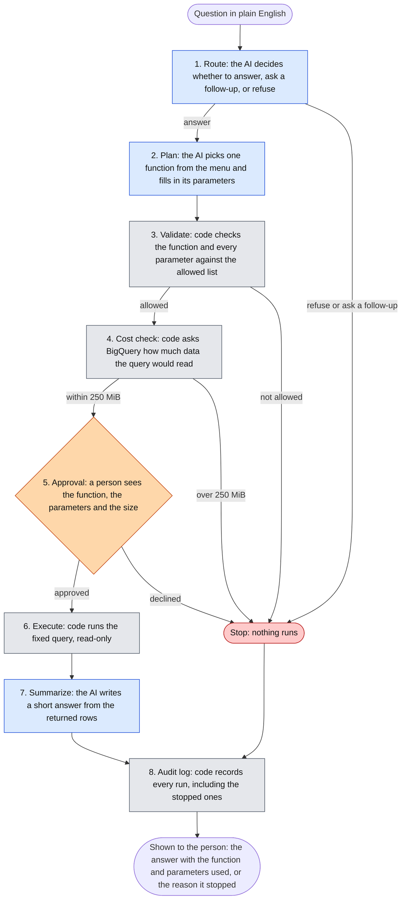

# bq-query-agent

A small AI agent that answers plain-English questions about a database, built so that the AI cannot run anything it has not been allowed to run, and a person approves every query before it runs.

Independent open-source work, built to learn Google Cloud (BigQuery) and LangGraph. It uses only public, synthetic data. It is not a production system.

## What is this?

Imagine asking a database, "What were our top products last quarter?" and getting an answer in plain English. The quick way to build that is to let an AI model write the database query itself. It works until the model writes a wrong query, an expensive one, or one that reads data it should not.

This project takes a different route. The AI never writes a query. Instead:

1. A short menu of pre-written, reviewed query functions exists (for example "revenue by month" or "top products").
2. The AI's only job is to choose one function from the menu and fill in the blanks (dates, a category, how many results).
3. Ordinary code, not the AI, checks the choice, estimates what the query would cost, and shows a person exactly what is about to run.
4. Only after a person approves does the query run, with read-only access, and every run is written to a log.

The short version of the rule: the model proposes, code decides.

The data is the public BigQuery dataset `thelook_ecommerce`, a synthetic online clothing store with orders, items, products and users. There is no real customer data anywhere in this repository.

## Status

This is a work in progress. The foundation is built and the agent itself is not yet.

| Built and in this repo | Not built yet |
|---|---|
| Design of the whole agent (`DESIGN.md`) | The six query functions as tested code |
| Metric definitions checked against the real data (`METRICS.md`) | The agent graph (route, plan, approve, run, summarize) |
| Reference SQL for five of the six functions, run against BigQuery and checked | Reference SQL for `average_order_value` |
| A script that runs queries under a 250 MiB per-query cap and writes a report | The model interface, approval step and audit log |
| Data-quality checks and their results (`sql/`) | The question set and the evaluation results |
| Notes on what went wrong and what was learned (`LESSONS.md`) | Terraform for the cloud setup |
| Python project setup with pinned versions | Tests |

## How it will work

This diagram shows the design. Blue steps use an AI model, grey steps are plain code, and the orange step is a person.



Only steps 1, 2 and 7 use the AI. Everything that decides whether something is allowed, affordable or safe is ordinary code that can be read, tested and trusted to behave the same way every time.

### The safety rules (design)

| Rule | What it prevents |
|---|---|
| Only functions on the menu can run | The AI inventing its own query |
| Every value is passed as a bound parameter | Text from a question being turned into SQL |
| Dates, counts and choices are checked against limits | Nonsense or oversized requests |
| A dry run estimates the data scanned before anything runs | A query that reads far more data than intended |
| A hard cap of 250 MiB per query, checked twice | A runaway query: once before approval, and again as a limit on the job itself |
| A person approves every query | Anything running without a human having seen it |
| Read-only access | Any change to the data |
| Results are aggregates only | Returning rows about an individual customer |
| An audit record for every request | Not knowing afterwards what ran and why |

## The data

The agent uses five tables from `bigquery-public-data.thelook_ecommerce`: `orders`, `order_items`, `products`, `inventory_items` and `users`.

Every number the agent reports depends on a definition, and these are written down in `METRICS.md`. In short:

1. An order is one distinct `order_id`.
2. An item is one row of `order_items`. Revenue and returns are counted per item.
3. A customer is a user with at least one order. 79,807 of the 100,000 registered users qualify.
4. A return is an item whose status is Returned.
5. Profit is the sale price minus the item's cost.
6. Revenue counts items that are not Cancelled or Returned. It is "final" once the order is 30 days old and "pending" before that. Pending is not a forecast, since those items can still be cancelled or returned.
7. The return rate is returned items divided by non-cancelled items whose 30-day window has closed.
8. Customers by traffic source counts distinct customers with at least one order in the date range, grouped by the traffic source stored on the user's record. A cancelled order still counts.
9. Every sale is dated by its order's creation time, and the "as of" date is the newest order. The evaluation questions use fixed dates that end on or before September 30, 2026.

The synthetic data has quirks, found by checking it, and they are listed in `METRICS.md`. The main ones:

- An item's timestamp differs from its order's timestamp for almost every item, by up to four days. That is why sales are dated by the order.
- 1,291 items are dated after the time of the check.
- 668 returns happened before the item was created, and 35,912 items shipped before they were created.
- Order volume ramps sharply from October 14, 2026, so the newest weeks do not look like the rest. The cause is not established.

## Project structure

Files marked "planned" do not exist yet. Their folders hold an empty placeholder so the layout is visible.

```
bq-query-agent/
├── README.md                  this file
├── LICENSE                    MIT license
├── DESIGN.md                  the design of the agent: steps, rules, evaluation plan
├── METRICS.md                 what every metric means, verified facts, known data problems
├── LESSONS.md                 what went wrong or surprised us, and what changed because of it
├── pyproject.toml             Python project definition and dependencies
├── uv.lock                    exact dependency versions (committed so installs match)
├── .python-version            pins Python 3.12 for uv
├── .gitignore                 keeps credentials, local logs and caches out of git
├── config/                    planned: dataset settings (tables, allowed values, the query menu)
├── src/
│   ├── agent/                 planned: the agent graph, its steps, model interface and audit log
│   └── functions/             planned: the six query functions
├── tests/                     planned: tests for the functions and the guardrails
├── eval/                      planned: the hand-written question set and its results
├── infra/                     planned: Terraform for the cloud setup
├── scripts/
│   ├── dry_run_queries.py     asks BigQuery how much data each reference query would read
│   └── run_queries.py         runs queries under the 250 MiB cap and writes a report
└── sql/
    ├── reference_queries.sql  the checked SQL for each query function
    ├── metrics_checks.sql     queries that checked the data and its quirks
    └── results/               the reports those scripts wrote
```

What the files do, in more detail:

| File | What it does |
|---|---|
| `DESIGN.md` | The plan for the whole agent. Covers what it will and will not do, the list of query functions, each step of the graph, the safety rules, the audit record, and how it will be evaluated. |
| `METRICS.md` | The single source of truth for what a number means. If a query and this file disagree, this file wins. Also holds the facts verified against the data and the list of known anomalies. |
| `LESSONS.md` | A running list of mistakes, surprises and decisions, each with what was done about it. |
| `scripts/dry_run_queries.py` | Reads the numbered queries in a SQL file and asks BigQuery for each one's estimated bytes without running it. With `--write` it records the estimate under each query. |
| `scripts/run_queries.py` | Dry-runs each numbered query, refuses any over the cap, runs the rest, and writes a Markdown report with the rows plus the estimated, processed and billed bytes. With `--only 1,3` it runs a subset and writes a separate file. |
| `sql/reference_queries.sql` | One query for each function that has reference SQL: revenue by period, top products, order status breakdown, return rate by category, and customers by traffic source. Dates are derived from the data. |
| `sql/metrics_checks.sql` | Eight checks: table sizes, whether order and item statuses agree, timestamp problems, customers by traffic source, the date range, order versus item timestamps, monthly volume and daily volume. |
| `sql/results/*.md` | The output of the two scripts above, kept so the evidence can be read without re-running anything. |

## Running it

You need a Google Cloud account with a project and billing enabled (the free tier is enough), the `gcloud` command-line tool, and [uv](https://docs.astral.sh/uv/).

```
gcloud auth application-default login
export GOOGLE_CLOUD_PROJECT=<your-project-id>
uv sync
uv run python scripts/dry_run_queries.py
uv run python scripts/run_queries.py
uv run python scripts/run_queries.py --file sql/reference_queries.sql
```

`uv sync` installs Python 3.12 and the dependencies. The first script runs nothing and only estimates the data scanned. The other two run real queries against the public dataset, and your project pays for them. Each query here scans under 25 MiB, and BigQuery's free tier covers the first 1 TiB each month. Nothing in the repo contains credentials, and the ignore file keeps it that way.

## Terms used

- **BigQuery.** Google Cloud's data warehouse. You pay for the amount of data a query reads.
- **Dry run.** Asking BigQuery how much data a query would read, without running it. It is free.
- **Bound parameter.** A value passed separately from the query text, so it can never be read as part of the query.
- **LangGraph.** A framework for building AI workflows as a graph of steps, including a pause where a person can approve.
- **Audit log.** A record of every request and what happened to it.

## License

MIT. See `LICENSE`.
