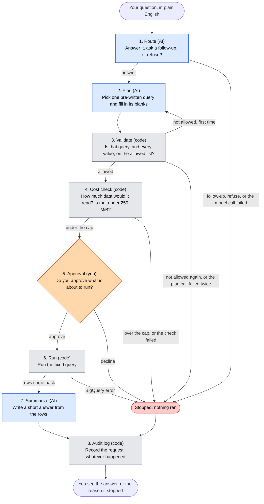
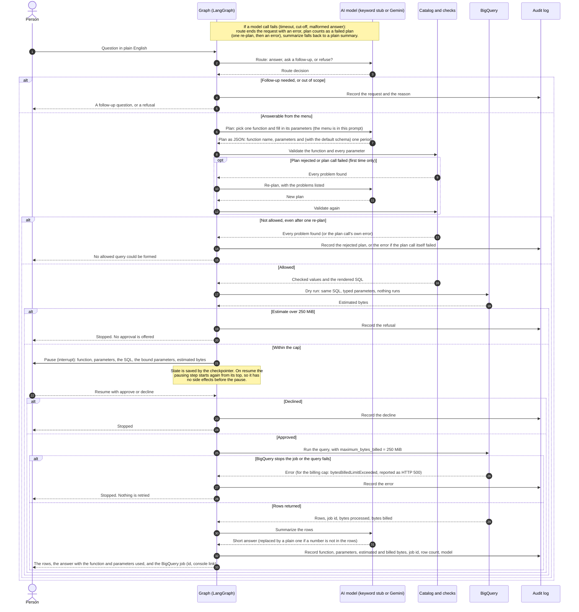
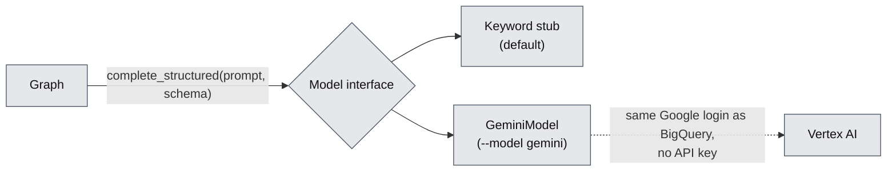

# bq-query-agent

A small AI agent that answers plain-English questions about a database, built so that the AI cannot run anything it has not been allowed to run, and a person approves every query before it runs.

Independent open-source work, built to learn Google Cloud (BigQuery) and LangGraph. It uses only public, synthetic data. It is not a production system.

## What is this?

Imagine asking a database, "What were our top products last quarter?" and getting an answer in plain English. The quick way to build that is to let an AI model write the database query itself. It works until the model writes a wrong query, an expensive one, or one that reads data it should not.

This project takes a different route. The AI never writes a query. Instead:

1. A short menu of pre-written, reviewed query functions exists (for example "revenue by month" or "top products").
2. The AI's only job is to choose one function from the menu and fill in the blanks (dates, a category, how many results).
3. Ordinary code, not the AI, checks the choice, estimates what the query would cost, and shows a person exactly what is about to run: the SQL and the values bound to it.
4. Only after a person approves does the query run, and every request is written to a log.

The short version of the rule: the model proposes, code decides.

The data is the public BigQuery dataset `thelook_ecommerce`, a synthetic online clothing store with orders, items, products and users. There is no real customer data anywhere in this repository.

## Status

This is a work in progress. The agent runs end to end, with a person approving each query. A keyword stub is the default model. A Gemini model on Google Cloud's Vertex AI can be used instead (`--model gemini`, see "Connecting a real model" below). The adapter is unit-tested with a fake client, and five tests call the real model. They passed on the last run, but one of them ("last year") depends on the model's answer and can fail (see "Connecting a real model"). Evaluation results are in "Evaluation" below.

| Built and in this repo | Not built yet |
|---|---|
| Design of the whole agent (`DESIGN.md`) | More than one held-out run: the only one used 24 questions I wrote myself |
| Metric definitions checked against the real data (`METRICS.md`) | Required, nullable fields for every parameter, not only dates, so an omitted metric or category cannot fall back to a default silently |
| Reference SQL for all six functions, run against BigQuery and checked | A read-only service account |
| The dataset config: tables, limits and the query menu with each function's parameters and SQL | |
| The six query functions as code (`src/functions/`): a loader that reads the config and fills its templates, and a runner that validates parameters, binds them as typed query parameters, dry-runs, refuses anything over 250 MiB and sets the same cap on the job | A durable checkpointer (state is kept in memory) |
| The agent graph (`src/agent/`): route, plan, validate, cost check, approval (a LangGraph `interrupt()`), execute, summarize and audit, with one re-plan after a rejected plan | Terraform for the cloud setup |
| A model interface, `complete_structured(prompt, schema)`, a keyword stub, and a Gemini adapter (`gemini_model.py`, settings in `config/model.yaml`) |  |
| A plan schema built from the config, so a model is shown the allowed function names, values and bounds (the code checks stay the real guard). Dates are asked for as one `period`, null or both dates, and flattened back to `start_date` and `end_date` before validation (`date_schema` in `config/thelook.yaml`) |  |
| `scripts/run_probe.py`, which compares configurations round robin on chosen questions; and `vocabulary_in_prompts` (off), a list of period definitions that can be added to the prompts |  |
| Prompt hardening: today's date in the plan prompt, the question escaped before it enters a prompt, a summary whose numbers are not in the rows replaced by a plain one |  |
| An audit log: one JSON line per request in `audit.jsonl`, including refused, rejected, over-cap and declined ones. A failed write is reported on stderr and the answer is still returned |  |
| A command-line demo (`scripts/ask.py`, `--model stub` or `--model gemini`) that shows the SQL and its bound parameters, asks for approval, then prints the rows and the BigQuery job it ran |  |
| Tests (`tests/`): config checks, validation, binding, both caps, every path through the graph with a stub BigQuery client, the SQL shown at approval equal to the SQL sent, and the demo's table formatting; and BigQuery tests that each function returns what its reference query returns, with default and with set parameters, and that both caps stop real queries |  |
| A script that runs queries under a 250 MiB per-query cap and writes a report |  |
| Data-quality checks and their results (`sql/`) |  |
| Notes on what went wrong and what was learned (`LESSONS.md`) |  |
| The 24-question set (`eval/questions.yaml`), the evaluation runner (`scripts/run_eval.py`) and the results in "Evaluation" |  |
| Python project setup with pinned versions |  |

## How it works

Read the diagram from the top. Blue steps use an AI model (a keyword stub by default; Gemini on Vertex AI with `--model gemini`), grey steps are ordinary code, and the orange step is a person. Red means the request stopped and nothing ran.



Only steps 1, 2 and 7 use the AI. Everything that decides whether something is allowed, affordable or safe is ordinary code that can be read, tested and trusted to behave the same way every time. A plan that is not allowed, or whose model call failed, gets one second try (step 2 again, with the problems listed) before the request stops. A failed summary does not stop anything: the rows are returned with a plain summary built by code.

### The same flow over time

The flowchart shows the steps. This diagram shows who talks to whom, in order, including every place a request can stop.



All of this is built and tested, with the keyword stub in place of the AI model. Using Gemini changes only the "AI model" column. Every request ends in the audit log, whether it was answered or stopped. The one exception is a request paused at approval and never resumed: it has not ended, so it has no audit line.

### Connecting a real model

The graph never talks to a particular AI model. It calls one function, `complete_structured(prompt, schema)`, and gets back a JSON answer. Two classes answer it: the keyword stub (default, no cloud access) and `GeminiModel`, which calls Gemini on Vertex AI. The graph is the same for both.



What the Gemini adapter does:

- **Settings** are in `config/model.yaml`: the model ID for each of route, plan and summarize (all `gemini-3.8-flash`), location `global`, temperature 0, a per-task output cap, and a request timeout. There are no keys. The project comes from `GOOGLE_CLOUD_PROJECT` or `gcloud config get-value project`, and the login from `gcloud auth application-default login`.
- **Output caps start at 2048** for each step, because Gemini 3.x thinking tokens count against the cap (`LESSONS.md`, lessons 17 and 19). Route, plan and summarize use `thinking_level: low` (plan's was chosen with `scripts/run_probe.py`, `LESSONS.md` lesson 21). A call that ends with `MAX_TOKENS`, and only that, is retried with the cap doubled, never above the step's ceiling (8192), at most 3 times. A call already cut off at the ceiling stops at once with an error. The number of attempts and the cap each call finished with are recorded, and the audit line has an `attempts` field per step.
- **It raises, and the graph handles it,** when the text is empty, the finish reason is not STOP (a cut-off or a safety block), the JSON does not parse, or the result is not an object. A route failure ends the request with status `error` ("could not be routed"). A plan failure is treated like a rejected plan: the graph re-plans once, and if that also fails the request ends with status `error` ("could not be planned") and the model's own error text, not a generic message. A summary failure is a plain fallback.
- **Timeouts and retries.** A timeout, 429 or 5xx is retried by the SDK: 3 attempts (two retries). Route has a 70 s timeout per attempt and plan 80 s (about 3 times the p99 of single-attempt calls in the date probe); summarize keeps the default 60 s, which was not measured. For a question whose calls keep timing out, a route that never answers ends the request after 3 x 70 = 210 s; a plan that never answers ends it after 2 x 3 x 80 = 480 s (the first plan and one re-plan), after a route call that timed out twice and then answered, so about 620 s, plus a few seconds of backoff. This is separate from the `MAX_TOKENS` retry: a 429 never uses up a cap retry. Running totals of prompt, output and thinking tokens are kept on the object.
- **The plan schema is built from the config** (`plan_schema` in `models.py`): `function` is an enum of the function names, and `params` lists every parameter any function uses, all optional, with the union of allowed values and bounds, dates as `format: date`, and no extra properties. With `date_schema: period` (the default in `config/thelook.yaml`), `start_date` and `end_date` are replaced by one required `period`, which is null or an object with both dates required; the graph flattens it back before validation, so a lone date cannot be written. `date_schema: flat` keeps the two optional dates. The schema narrows what the model writes. The validate node is still the real guard, because it knows which parameters belong to which function.
- **Prompts.** The route prompt carries today's date (UTC), the function names with a one-line description each, and the rules for answer, clarify and refuse. The plan prompt carries today's date and one date rule: no period named, `period` is null; a period named, both dates, counted from today's date (with `flat`: neither date, or both). A `vocabulary` in `config/thelook.yaml` can add "Terms" to the route and plan prompts; `vocabulary_in_prompts` is false because the test showed no gain (`LESSONS.md`, lesson 20). The question is escaped (`<`, `>` and `&`) before it enters any prompt, so text such as `</question>` cannot close the tag.
- **The summary check.** After summarize, every number in the summary must appear in the returned rows, allowing thousands separators, rounding to the precision shown, a percent for a fraction, and the row count. If one does not, the summary is replaced by the row count and the first row, built by code, and the audit line has `summary_fallback: true`. A true figure the check does not recognise, such as "1.2 million", is replaced too.

Tested so far: the adapter with a fake client, the plan schema, the prompt, the escaping, the summary check, the date-pair rule, the audit failure and the demo's formatting, all without cloud access. `tests/test_gemini_integration.py` has five tests that call real Gemini (seven requests in all: top products, a request for email addresses, "revenue by month for last year", an injection attempt and a vague question). All five passed on the last run, with a stub BigQuery client. What they showed:

- With separate dates the real model often left out `end_date` (about half of the first plans for the date-heavy questions in the probe). The validate node rejects a window with only one end (lesson 18). With the `period` schema the probe saw no lone date in 40 first plans (lesson 21).
- The route prompt now says that `reason` is shown to the person and must be a question for `clarify`. Without that, the model described the problem instead of asking.
- At temperature 0 the same question ("orders status since 2026-03-01") routed three different ways in three runs: clarify, refuse, and a failed call that stopped at `MAX_TOKENS` with the 1024-token route cap. Lesson 19 follows that up.
- Evaluation runs decline every request at the approval step, so they never call summarize or the summary check. The timeout values were set from one probe and not tuned further (a shorter timeout was not tried).

### The safety rules

| Rule | What it prevents | Status |
|---|---|---|
| Only functions on the menu can run | The AI inventing its own query | Built and tested (`src/functions/queries.py`) |
| Every value is passed as a typed bound parameter | Text from a question being turned into SQL | Built and tested |
| Dates, counts and choices are checked against limits | Nonsense or oversized requests | Built and tested |
| A date window must give both `start_date` and `end_date`, or neither | A plan that is valid but wrong: with only `start_date`, the window silently runs to the latest data. Gemini did this in about half the runs for "last year" | Built and tested with fake models, and still the backstop. The default `period` schema makes a lone date impossible to write: 0 of 40 first plans on the date-heavy probe, against 19 of 40 with separate dates (`LESSONS.md`, lessons 18 and 21). With separate dates and real Gemini on "last year" (6 runs), 4 plans were correct and 2 were rejected after the re-plan repeated the mistake |
| A dry run estimates the data scanned before anything runs | A query that reads far more data than intended | Built and tested |
| A hard cap of 250 MiB per query, checked twice | A runaway query: once on the dry-run estimate, and again as `maximum_bytes_billed` on the job itself | Built and tested on real jobs with a lowered cap |
| A person approves every query | Anything running without a human having seen it | Built and tested (`src/agent/graph.py`). Only `True` or `{"approved": true}` approves; any other answer declines |
| Read-only access | Any change to the data | Not built. Queries run as whoever is logged in to `gcloud`. The dataset itself is public and read-only. |
| Results are aggregates only | Returning rows about an individual customer | In the SQL of all six functions; there is no separate check |
| An audit record for every request | Not knowing afterwards what ran and why | Built and tested: one JSON line per request in `audit.jsonl` (`src/agent/audit.py`) |

## Decisions so far

- **The model never writes SQL.** It picks one of six reviewed functions and fills in parameters; code validates them and a person approves.
- **Sales are dated by the order's timestamp,** and `METRICS.md` wins when code and the metric definitions disagree.
- **Two 250 MiB checks:** a dry run before approval and `maximum_bytes_billed` on the job.
- **Dates are one `period` object by default.** The model had written a `start_date` without an `end_date` in about half of the first plans for date-heavy questions, which silently runs to the latest data. A prompt vocabulary of period definitions did not help (lone dates doubled) and is off. Requiring both dates or neither removed it (`LESSONS.md`, lessons 20 and 21).
- **Plan thinking is `low`.** In the probe it matched the best accuracy with the shortest plan calls (lesson 21).
- **Per-task timeouts** of 70 s (route) and 80 s (plan), 3 attempts, with the worst-case wait stated (see "Connecting a real model").
- **The demo shows its evidence.** At approval it prints the exact SQL and the bound values; after the run it prints the rows and the BigQuery job id with a console link, so the answer can be traced to BigQuery and checked against the rows.
- **A failed model call keeps its real error** in the request's status and audit line instead of being reported as an invalid plan.
- **Questions are not edited to fit the agent.** The 24 evaluation questions are fixed; a separate held-out set is run once to check for overfitting.

## The data

The agent uses five tables from `bigquery-public-data.thelook_ecommerce`: `orders`, `order_items`, `products`, `inventory_items` and `users`.

Every number the agent reports depends on a definition, and these are written down in `METRICS.md`. In short:

1. An order is one distinct `order_id`.
2. An item is one row of `order_items`. Revenue and returns are counted per item.
3. A customer is a user with at least one order. 79,807 of the 100,000 registered users qualify.
4. A return is an item whose status is Returned.
5. Profit is the sale price minus the item's cost.
6. Revenue counts items that are not Cancelled or Returned. It is "final" once the order is 30 days old and "pending" before that. Pending is not a forecast, since those items can still be cancelled or returned.
7. The return rate is returned items divided by non-cancelled items whose 30-day window has closed.
8. Customers by traffic source counts distinct customers with at least one order in the date range, grouped by the traffic source stored on the user's record. A cancelled order still counts.
9. Every sale is dated by its order's creation time, and the "as of" date is the newest order. The evaluation questions use fixed dates that end on or before September 30, 2026.
10. Average order value is revenue (as in item 6) divided by the number of orders that contribute to it, so cancelled and returned orders are left out.

The synthetic data has quirks, found by checking it, and they are listed in `METRICS.md`. The main ones, as counted on October 26, 2026:

- An item's timestamp differs from its order's timestamp for almost every item, by up to four days. That is why sales are dated by the order.
- 1,291 items are dated after the time of the check.
- 668 returns happened before the item was created, and 35,912 items shipped before they were created.
- Order volume ramps sharply from October 14, 2026, so the newest weeks do not look like the rest. The cause is not established.

The public dataset is regenerated, not just extended. By October 27 every month's order count had changed, so the exact figures above and in `METRICS.md` describe one snapshot. Evaluation answers therefore cannot be stored once as fixed numbers (`LESSONS.md`, lesson 13).

## Asking the agent

```
uv run python scripts/ask.py "top 5 products by profit in Jeans from 2026-01-01 to 2026-09-30"
uv run python scripts/ask.py "revenue by month for last year" --model gemini
```

The demo routes and plans the question with a model (`--model stub`, the default, or `--model gemini`), validates the plan, and dry-runs it. It then shows the function, the parameters, the estimated bytes, the SQL that will run and the bound parameters (the values are never pasted into the SQL text), and asks `Run this query? [y/N]`. Only `y` runs the query. Then it prints the first rows (`--rows N`, default 10), the model's short summary with the function, parameters and bytes used, and the BigQuery job: its id, a link to it in the Cloud console, and a `bq show -j` command that prints the same job from a terminal. It appends one line to `audit.jsonl`, which includes the job id. A refused, rejected, over-cap or declined request prints no SQL and no rows. Use `--audit <path>` to write the log somewhere else. `--model gemini` sends a few small requests to Vertex AI, billed to your project.

Sample run with `--model gemini` (the SQL is shortened to its first and last lines here; the demo prints all of it, and the long summary sentence is left out):

```
Function:  top_products
Params:    {'category': 'Jeans', 'metric': 'profit', 'n': 5, 'start_date': '2026-01-01', 'end_date': '2026-09-30'}
Estimate:  21,960,635 bytes (cap 262,144,000)

SQL that will run (values are bound parameters, not pasted into the text):
WITH d AS (
...
ORDER BY profit DESC, product_id
LIMIT @n

Bound parameters:
@category = Jeans (STRING)
@end_date = 2026-09-30 (DATE)
@n = 5 (INT64)
@start_date = 2026-01-01 (DATE)

Run this query? [y/N]
Rows
product_id  product_name                              category   revenue  units  profit
----------  ----------------------------------------  --------  --------  -----  ------
     20953  True Religion Men's Ricky Straight Vint…  Jeans     1,172.00      4  552.01
     20631  True Religion Men's Bobby Zipper Jean     Jeans     1,144.00      4  546.83
     21227  Diesel Men's Braddom Regular Carrot-Leg…  Jeans     1,050.00      3  537.60
     21503  True Religion Men's Billy Super Big Jean  Jeans     1,035.00      3  493.70
     21531  Diesel Men's Safado Slim Straight-Leg J…  Jeans       975.00      3  492.38

BigQuery job: 7868e405-ce5a-4b05-8e8a-a070c1a9f9d4 (US), processed 21,960,635 bytes, billed 41,943,040 bytes
https://console.cloud.google.com/bigquery?project=bq-query-agent&j=bq:US:7868e405-ce5a-4b05-8e8a-a070c1a9f9d4&page=queryresults
bq show -j --location=US 7868e405-ce5a-4b05-8e8a-a070c1a9f9d4
```

This is the fifth try. The model does not always plan this question correctly: in 10 evaluation runs of it (q03), one left out `category`, and in 10 runs of the same words in lower case through `ask.py`, 4 did (plans only, declined at approval). Four of the five tries for this sample left out `category` too, and the first demo run left out `metric` and `category`. The approval screen shows it before anything runs (`@category = NULL`), and the rows show it afterwards. See `LESSONS.md`, lesson 22.

The keyword stub matches words such as "top", "revenue", "return rate" and "traffic source", picks up a category, "by quarter", "top N" and ISO dates, and refuses questions that mention SQL, personal data or instructions. It exists to drive the graph and its tests. It is not a language model, and it misreads anything phrased differently.

## Evaluation

How well does the agent pick the right query and the right parameters? This is measured, not
guessed. The scorer lives in `scripts/run_eval.py` and the questions in `eval/questions.yaml`.

**What is scored.** For each question the agent's route (answer, clarify or refuse), its
function and its parameters are compared with what the question fixes. A parameter the agent
omits counts as its default; a parameter set to its default is fine. Nothing is run on BigQuery
while scoring, so an evaluation costs only the model calls. The functions themselves are
checked against reference SQL in `tests/test_reference_match.py`, so a correct function with
correct parameters is a correct answer.

**The questions.** 24 hand-written questions in five groups: plain questions (12), relative
dates such as "last quarter" (4), questions that must be refused (4), questions that need a
follow-up (3) and a question with no dates, which must use the defaults (1). Relative dates are
resolved against a pinned date (2026-10-28) so the expected values do not go stale.

### Results

Each run asks every question three times, because the model is not deterministic even at
temperature 0. The keyword stub is a single run.

| Run | What changed | Passed | Wrong answers | Errors |
| --- | --- | --- | --- | --- |
| Keyword stub (no model) | A keyword matcher | 12 of 24 (50%) | 12 | 0 |
| Gemini baseline | First prompts | 52 of 72 (72%) | 13 | 7 |
| After fix round 1 | Today's date in the route prompt; both dates or neither | 68 of 72 (94%) | 3 | 1 |
| After fix round 2 | Dates as one required period object; low plan thinking; per-task timeouts | 72 of 72 (100%) | 0 | 0 |
| Held-out set, run once | 24 new questions written after the prompts were frozen | 67 of 72 (93%) | 5 | 0 |

"Errors" are timeouts and quota errors from Vertex AI that ended a request. They are counted as
failures and shown in their own column, not removed from the total. A call that timed out and
then succeeded on a retry is not an error here, so a run with no errors can still contain slow
calls.

### How to read these numbers

- The first four rows use the same 24 questions the prompts were tuned on. They show that the
  fixes worked on those questions, not how the agent does on new ones, and 72 of 72 is a
  ceiling, not a promise.
- The held-out questions were written after the prompts were frozen, run once, and are not in
  this repository, so they stay unseen. The result is 67 of 72. Three questions account for
  all five misses. One of them (3 of the 5) is a definition: a question about a trailing
  three-month window was read as a rolling window ending today, where I had expected the three
  most recent complete calendar months. Both readings are defensible; the miss is against my
  convention. The other two are single runs where the route flipped: refusing a question it
  answered in the other two runs, and answering a vague question instead of asking a follow-up.
- Three runs per question is enough to see a 15 point change and not enough to see a 3 point
  one. A 7 point gap between the last two rows is consistent with some tuning to the first
  set; it is not enough on its own to say how much.
- The held-out set is 24 questions I wrote myself. It is a check against overfitting, not a
  benchmark.

### What went wrong, and what was changed

- The model sometimes wrote a `start_date` and no `end_date`, which silently runs to the latest
  data. A prompt vocabulary defining "quarter", "last year" and similar did not help: lone dates
  doubled, and they appeared even when the question stated both dates (LESSONS.md, lesson 20).
  Making the plan schema require both dates or neither removed the failure: on the ten
  date-heavy questions, first plans with a lone date went from 19 of 40 to 0 of 40, and none
  occurred in either full run since (LESSONS.md, lesson 21).
- Vertex AI timeouts (504) took most of the extra time in one run. The fix, per-task timeouts of
  70 s (route) and 80 s (plan) with 3 attempts, trades fewer failed requests for a long worst
  case, about 10 minutes for a call that never answers. A shorter timeout was not tried.
- Call latency has a long tail: in the held-out run the median request took 8.3 s and the slowest
  106 s, and the 72 requests took 1,383 s in total against 691 s for the 72 requests of the
  earlier full run. The result files do not show how many calls were retried inside the SDK, so
  the cause of the difference is not established.

### Run it

```
uv run python scripts/run_eval.py --model stub
uv run python scripts/run_eval.py --model gemini --runs 3 --workers 2 --label my-run
```

Results are written to `eval/results/` as a Markdown summary and a JSON file with every
question's raw outcome. That folder is not committed. To check generalisation yourself, write
your own questions in the same format and pass them with `--questions`.

## Using the query functions

The six functions can be called from Python today, without the agent. A call is checked, dry-run and capped before it runs:

```python
from functions import run

result = run("top_products", {"metric": "profit", "n": 5, "category": "Jeans",
                              "start_date": "2026-01-01", "end_date": "2026-09-30"})
result.columns          # ['product_id', 'product_name', 'category', 'revenue', 'units', 'profit']
result.rows             # one tuple per row
result.estimated_bytes, result.processed_bytes, result.billed_bytes
```

Parameters that are left out take their defaults. Dates fall back to the 12 calendar months ending at the newest order. A call can fail in three ways, and nothing runs in the first two:

- `ValidationError`: the function, a parameter name or a value is not allowed. Its `errors` list holds every problem found.
- `OverCapError`: the dry-run estimate is over 250 MiB.
- `BilledLimitError`: BigQuery stopped the job at `maximum_bytes_billed`.

`run()` is `prepare()`, `estimate()` and `execute()` in one call. The agent calls them separately, so a person can approve between the estimate and the run:

```python
from functions import estimate, execute, load, prepare

prepared = prepare(load(), "revenue_by_period", {"group_by": "quarter"})
estimated = estimate(prepared)       # dry run; raises OverCapError over the cap
result = execute(prepared, estimated_bytes=estimated)
```

The project is not installed as a package, so put `src` on the path when running a script: `PYTHONPATH=src uv run python your_script.py`. The tests set this up themselves.

## Project structure

Files marked "planned" do not exist yet. The `infra/` folder holds an empty placeholder so the layout is visible. `eval/results/` is written by the scripts and is not committed.

```
bq-query-agent/
├── README.md                  this file
├── LICENSE                    MIT license
├── DESIGN.md                  the design of the agent: steps, rules, evaluation plan
├── METRICS.md                 what every metric means, verified facts, known data problems
├── LESSONS.md                 what went wrong or surprised us, and what changed because of it
├── pyproject.toml             Python project definition and dependencies
├── uv.lock                    exact dependency versions (committed so installs match)
├── .python-version            pins Python 3.12 for uv
├── .gitignore                 keeps credentials, local logs and caches out of git
├── config/
│   ├── thelook.yaml           dataset settings: tables, limits, and the query menu with each function's parameters and SQL
│   └── model.yaml             which model each step uses, its settings, and the Google Cloud location
├── src/
│   ├── agent/
│   │   ├── __init__.py        the public names: build_graph and the model classes
│   │   ├── graph.py           the graph: its state, its eight nodes and the edges between them (a plan call that fails ends in status `error`)
│   │   ├── models.py          the model interface, the output schemas (the plan schema is built from the catalog), prompt escaping and the keyword stub
│   │   ├── gemini_model.py    the same interface, answered by Gemini on Vertex AI
│   │   ├── summary_check.py   checks that a summary's numbers appear in the rows, and builds the plain fallback
│   │   ├── display.py         formats the rows, bound parameters and BigQuery job links for the demo
│   │   └── audit.py           appends one JSON line per request to the audit log
│   └── functions/
│       ├── __init__.py        the public names: run, prepare, estimate, execute, load and the error types
│       ├── catalog.py         loads the config and fills each function's SQL template
│       ├── queries.py         validates a call, binds its parameters, dry-runs, caps and runs it
│       └── fake_client.py     a stand-in BigQuery client, used by the tests and the evaluation runner
├── tests/
│   ├── test_catalog.py        the loader and the config checks (no cloud access)
│   ├── test_queries.py        validation, binding and both caps, with a stub client (no cloud access)
│   ├── test_agent.py          every path through the graph, with a stub client (no cloud access)
│   ├── test_gemini_model.py   the Gemini adapter with a fake client (no cloud access)
│   ├── test_plan_schema.py    the plan schema built from the catalog (no cloud access)
│   ├── test_hardening.py      today's date in the prompt, escaping, the summary check, a failed audit write (no cloud access)
│   ├── test_gemini_integration.py  five questions against real Gemini, with a stub BigQuery client (integration)
│   ├── test_display.py        the demo's table, parameter and link formatting (no cloud access)
│   ├── test_audit.py          the audit line's fields, including job_id (no cloud access)
│   ├── test_run_eval.py       the evaluation scorer and the run counting (no cloud access)
│   ├── test_run_probe.py      the probe's counting, `--set` overrides and a round-robin run with the stub (no cloud access)
│   ├── test_period_schema.py  the period date schema, flattening, and a plan call that fails (no cloud access)
│   ├── resolve_period.py      period phrase to dates, used only by tests
│   ├── test_resolve_period.py that function against hand-worked dates and the `period:` notes in the question set (no cloud access)
│   └── test_reference_match.py  each function against its reference SQL, and both caps on real jobs
├── eval/
│   ├── questions.yaml         the 24 hand-written evaluation questions, each with what a correct answer is, and the pinned date
│   └── results/               reports and audit files written by run_eval.py and run_probe.py (not committed)
├── infra/                     planned: Terraform for the cloud setup
├── scripts/
│   ├── ask.py                 command-line demo: ask one question, approve or decline, see the answer
│   ├── run_eval.py            runs eval/questions.yaml through the graph with a stub or Gemini, scores it, writes a report under eval/results/
│   ├── run_probe.py           compares configurations round robin on chosen questions
│   ├── dry_run_queries.py     asks BigQuery how much data each reference query would read
│   ├── run_queries.py         runs queries under the 250 MiB cap and writes a report
│   └── vertex_smoke_test.py   sends a plain and a structured-output request to a model, to check access before building on it
└── sql/
    ├── reference_queries.sql  the checked SQL for each query function
    ├── metrics_checks.sql     queries that checked the data and its quirks
    └── results/               the reports those scripts wrote
```

What the files do, in more detail:

| File | What it does |
|---|---|
| `DESIGN.md` | The plan for the whole agent. Covers what it will and will not do, the list of query functions, each step of the graph, the safety rules, the audit record, and how it will be evaluated. |
| `METRICS.md` | The single source of truth for what a number means. If a query and this file disagree, this file wins. Also holds the facts verified against the data and the list of known anomalies. |
| `LESSONS.md` | A running list of mistakes, surprises and decisions, each with what was done about it. |
| `config/thelook.yaml` | The one file that holds everything specific to this dataset: table names, the 250 MiB cap, allowed values such as the 26 product categories, `date_schema` (`period` or `flat`), the optional `vocabulary` of period definitions and its switch `vocabulary_in_prompts` (off), and for each of the six functions its description, parameters, bounds and SQL template. Read by `src/functions/catalog.py`, which checks it for consistency when it loads. |
| `src/functions/catalog.py` | Reads the config and fills each `{placeholder}` in a function's SQL from the tables, constants, snippets or the function's own slots. An unknown name is an error, and every template is rendered once at load so a bad one fails early. Values from a question never enter a template. |
| `src/functions/queries.py` | Checks a call against the catalog (known function and parameters, allowed values, number bounds, date limits, start not after end), binds every value as a typed query parameter (an omitted date or category is a typed NULL), dry-runs, refuses anything over the cap, runs with the cap as `maximum_bytes_billed`, and returns the rows with estimated, processed and billed bytes. |
| `src/agent/graph.py` | Builds the LangGraph graph. Route, plan and summarize call the model; validate, cost check, approval, execute and audit are code. A rejected plan gets one re-plan with the errors listed. Approval pauses with `interrupt()` and resumes with `Command(resume=...)`, using the in-memory checkpointer. The approval node does nothing before the pause, because LangGraph runs it again from the top on resume. |
| `src/agent/models.py` | The interface a model must meet, `complete_structured(prompt, schema)`, the route and summary schemas, `plan_schema(catalog, date_schema)` and `flatten_plan` (the `period` object back to two dates), `escape_text`, and the keyword stub. The graph checks whatever comes back: an unknown route counts as a refusal, and a plan goes through validation. |
| `src/agent/gemini_model.py` | `GeminiModel`: calls Gemini on Vertex AI as set in `config/model.yaml`, raises on an empty, cut-off, blocked or malformed answer, and counts tokens. See "Connecting a real model". |
| `src/agent/summary_check.py` | Finds numbers in a summary that are not in the rows, and builds the plain fallback summary. |
| `src/agent/display.py` | Text for the demo, as pure functions: the rows as an aligned table, the bound parameters, the console link and the `bq show` command. |
| `src/agent/audit.py` | Writes one JSON line per request: time, an id, question, route, status, function, parameters, estimated, processed and billed bytes, the BigQuery job id, approval, row count, error, model name, whether the summary fallback was used, and the attempts and token cap of each model step. |
| `config/model.yaml` | Which Gemini model each step uses, the location, temperature, per-task output caps and ceilings, thinking level, timeouts (route and plan have their own) and retry counts, with the worst-case wait. No keys. |
| `scripts/run_probe.py` | Runs several configurations (name plus `--set KEY=VALUE`) on chosen questions, round robin, and writes `eval/results/probe-<label>.md` and `.json`: first-plan and final pass rates, lone dates, rejections, errors by kind, plan-call seconds and tokens. |
| `scripts/ask.py` | The command-line demo described under "Asking the agent". |
| `scripts/run_eval.py` | Sends each question in `eval/questions.yaml` through the graph (`--model stub` or `gemini`, `--runs N`, `--ids`, `--set KEY=VALUE` to override one config value for the run) with the date pinned to the file's date and a fake BigQuery client, declines every request at the approval step, scores route, function and parameters by the rules in the file's header, and writes a Markdown and a JSON report to `eval/results/`. Only the model calls cost anything. |
| `tests/` | `test_catalog.py`, `test_queries.py`, `test_agent.py`, `test_gemini_model.py`, `test_plan_schema.py`, `test_period_schema.py`, `test_display.py`, `test_audit.py`, `test_hardening.py`, `test_run_eval.py`, `test_run_probe.py` and `test_resolve_period.py` need no cloud access. `test_agent.py` covers approve, decline, over the cap, a plan rejected after one re-plan, refuse and clarify, and checks the audit line for each. `test_reference_match.py` is marked integration and is skipped without credentials. It checks each function against its reference query, with default parameters and with set ones (the reference SQL edited to literal values), and runs real queries against a lowered cap to check that the dry-run refusal and `maximum_bytes_billed` both work. `test_gemini_integration.py` is also marked integration and is skipped without credentials. |
| `scripts/dry_run_queries.py` | Reads the numbered queries in a SQL file and asks BigQuery for each one's estimated bytes without running it. With `--write` it records the estimate under each query. |
| `scripts/run_queries.py` | Dry-runs each numbered query, refuses any over the cap, runs the rest, and writes a Markdown report with the rows plus the estimated, processed and billed bytes. With `--only 1,3` it runs a subset and writes a separate file. |
| `scripts/vertex_smoke_test.py` | Sends two tiny real requests to a model (a plain message and a structured-output request with the same kind of schema the plan will use) and prints each result, with the likely cause of any failure. It tests Gemini on Vertex AI, using your Google login, and fails on an empty reply or a finish reason other than STOP. It exists because access and quota are decided outside the code (`LESSONS.md`, lesson 16). |
| `sql/reference_queries.sql` | One query for each of the six functions: revenue by period, top products, order status breakdown, average order value, return rate by category, and customers by traffic source. Dates are derived from the data. |
| `sql/metrics_checks.sql` | Nine checks: table sizes, whether order and item statuses agree, timestamp problems, customers by traffic source, the date range, order versus item timestamps, monthly volume, daily volume and the list of product categories. |
| `sql/results/*.md` | The output of the two scripts above, kept so the evidence can be read without re-running anything. |

## Running it

You need a Google Cloud account with a project and billing enabled (the free tier is enough), the `gcloud` command-line tool, and [uv](https://docs.astral.sh/uv/).

```
gcloud auth application-default login
export GOOGLE_CLOUD_PROJECT=<your-project-id>
uv sync
uv run python scripts/dry_run_queries.py
uv run python scripts/run_queries.py
uv run python scripts/run_queries.py --file sql/reference_queries.sql
uv run pytest -m "not integration"
uv run pytest
uv run python scripts/ask.py "revenue by quarter"
uv run python scripts/run_eval.py --model stub     # or: --model gemini --runs 3 (bills Vertex AI)
# compare two settings on a few questions, round robin (bills Vertex AI):
uv run python scripts/run_probe.py --model gemini --label dates --ids q02,q06 --runs 4 --per-round 2 \
    --variant "A" --variant "B date_schema=flat"
```

`uv sync` installs Python 3.12 and the dependencies. The first script runs nothing and only estimates the data scanned. The other two scripts run real queries against the public dataset, and your project pays for them. The first `pytest` line needs no cloud access. The second also runs the integration tests, which send about 40 queries to BigQuery. Each query here scans under 25 MiB, and BigQuery's free tier covers the first 1 TiB each month. Nothing in the repo contains credentials, and the ignore file keeps it that way.

## Terms used

- **BigQuery.** Google Cloud's data warehouse. You pay for the amount of data a query reads.
- **Dry run.** Asking BigQuery how much data a query would read, without running it. It is free.
- **Bound parameter.** A value passed separately from the query text, so it can never be read as part of the query.
- **LangGraph.** A framework for building AI workflows as a graph of steps, including a pause where a person can approve.
- **Audit log.** A record of every request and what happened to it.
- **Vertex AI.** Google Cloud's service for running AI models, including Gemini. Calls are billed to your Google Cloud project and use the same login as BigQuery.
- **Structured output.** A way of making a model answer in a fixed JSON shape, so code can check the answer instead of guessing at text.
- **Interrupt.** A LangGraph pause. The graph saves its state and waits, and it carries on when it is resumed with an answer.
- **Period.** How the plan asks for dates by default: one field that is null (no period named) or holds both a start and an end date. The code turns it back into `start_date` and `end_date` before checking it.
- **Thinking level.** How much hidden reasoning Gemini does before it answers (`low`, `medium`, `high`). Those thinking tokens count against the output cap.
- **Held-out set.** Questions written after the prompts were frozen, so they show how the agent does on questions it was not tuned on.
- **Probe.** A comparison of settings on the same questions, run in rounds so each setting meets the same service conditions (`scripts/run_probe.py`).
- **Checkpointer.** Where LangGraph keeps a paused graph's state. Here it is in memory, so a paused request is lost if the process stops.

## License

MIT. See `LICENSE`.
